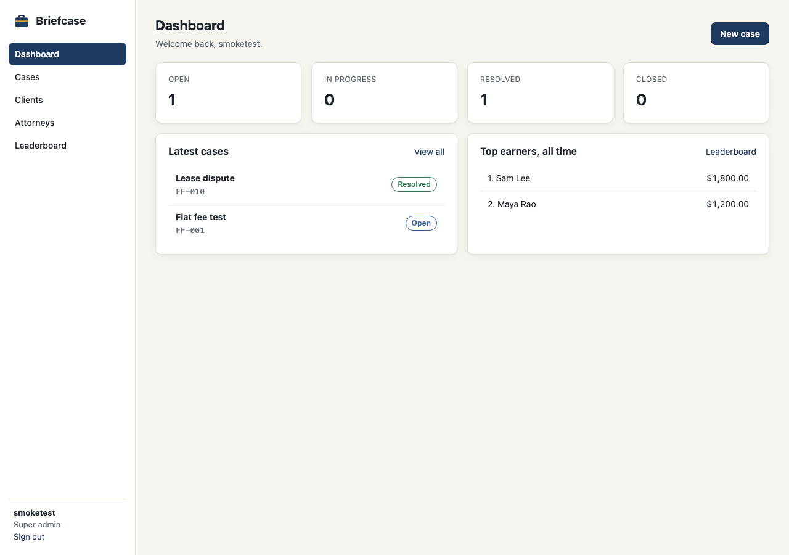
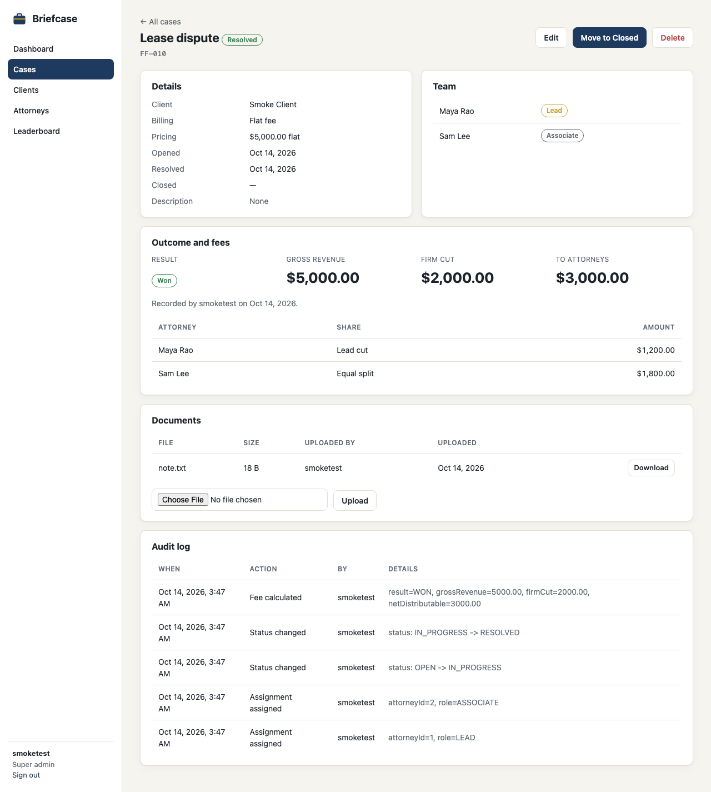
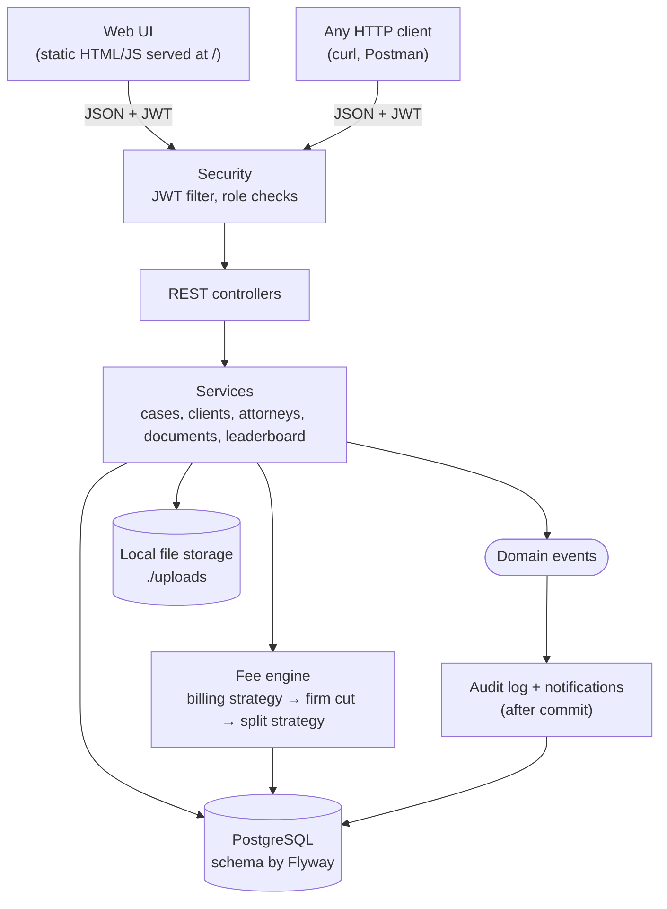

# Briefcase

Briefcase is a case management app for small law firms. It keeps track of clients, the
attorneys working each case, the documents attached to it, and what the case earned once
it closes. When a case is won, settled or lost, Briefcase works out the revenue, takes the
firm's share and pays out the rest to the team automatically.

It ships as a single Spring Boot application: a REST API plus a built-in web UI, backed by
PostgreSQL.



## What it does

| Area | What you can do |
| --- | --- |
| **Cases** | Open a case for a client, search and filter the caseload, move a case through *Open → In progress → Resolved → Closed* |
| **Team** | Put attorneys on a case as Lead, Associate or Paralegal (one Lead per case) |
| **Billing** | Bill a case by **contingency** (a share of the settlement), **hourly** (rate × hours) or **flat fee** |
| **Payouts** | Record the outcome once; Briefcase splits the fee between the firm and the attorneys |
| **Documents** | Upload files to a case and download them later |
| **Leaderboard** | Rank attorneys by revenue, win rate or cases led, for this month, quarter, year or all time |
| **Audit log** | Every status change, assignment and payout is logged for admins |
| **Access control** | Six user roles; each screen and API call checks what your role is allowed to do |



## How fees are split

When an attorney records the outcome of a resolved case:

1. **Revenue** is calculated from the billing type: settlement × contingency rate, hours × hourly rate, or the flat fee.
2. **The firm** keeps 40% of revenue.
3. **The Lead attorney** gets 40% of what's left.
4. **Associates** share the remainder equally. Paralegals don't take a share, and a Lead working alone gets the whole remainder.

Example: a $5,000 flat-fee case with one Lead and one Associate pays $2,000 to the firm,
$1,200 to the Lead and $1,800 to the Associate.

Both percentages can be changed in `application.yml`. A case can only be paid out once:
the app checks a flag on the case, and the database refuses a second payout row for the
same attorney.

## Architecture



- **One package per feature.** `cases`, `billing`, `client` and the others each hold their own entity, repository, service, controller and DTOs. Database entities never leave the service layer.
- **Pluggable rules.** Each billing type is a small strategy class, chosen at runtime by the case's billing type. Adding a new type means one new class; the fee engine doesn't change. Fee splitting and leaderboard metrics work the same way.
- **Events for side effects.** Changing a case publishes an event. The audit log listens for it and writes its entry only after the main transaction commits.
- **Safe concurrent edits.** Cases carry a version number, so if two people save the same case at once, the second gets a clear conflict error instead of silently overwriting the first.

### Project layout

```
src/main/java/com/krishna/briefcase/
├── auth/          login, registration, JWT, security rules
├── client/        client records
├── attorney/      attorney records (optionally linked to a login)
├── cases/         cases, status lifecycle, team assignments, search
├── outcome/       recording a result (won / lost / settled)
├── billing/       revenue strategies, firm cut, fee split, payouts
├── leaderboard/   ranking strategies
├── storage/       document upload/download
├── audit/         audit trail
├── notification/  event listener for notifications
└── common/        errors, base entity, role constants
src/main/resources/
├── application.yml
├── db/migration/  Flyway SQL migrations (V1 to V6)
└── static/        the web UI (index.html, css/, js/)
```

## Tech stack

Java 21 · Spring Boot 4.1 · Spring Security with JWT · Spring Data JPA · PostgreSQL ·
Flyway · Maven · plain HTML, CSS and JavaScript for the UI (no build step).

## Run it locally

### 1. Install the prerequisites

You need **Java 21** and **PostgreSQL 14 or newer**. Maven is not needed; the project includes a Maven wrapper (`./mvnw`).

**macOS (Homebrew)**
```bash
brew install openjdk@21 postgresql@16
brew services start postgresql@16
export JAVA_HOME=$(/usr/libexec/java_home -v 21)
```

**Ubuntu / Debian**
```bash
sudo apt install openjdk-21-jdk postgresql
sudo systemctl start postgresql
```

**Windows:** install [Temurin JDK 21](https://adoptium.net/temurin/releases/?version=21) and
[PostgreSQL](https://www.postgresql.org/download/windows/), then use `mvnw.cmd` instead of `./mvnw` below.

Check with `java -version`; it should print 21.

### 2. Get the code

```bash
git clone https://github.com/KrishnaChittella/briefcase.git
cd briefcase
```

### 3. Create the database

Create a database user and a database it owns. Pick your own password:

```bash
psql -d postgres -c "CREATE ROLE briefcase_app LOGIN PASSWORD 'pick-a-password';"
createdb -O briefcase_app briefcase
```

On Linux you may need to run these as the `postgres` user, e.g.
`sudo -u postgres psql -c "..."` and `sudo -u postgres createdb -O briefcase_app briefcase`.

You don't need to create any tables. Flyway builds the schema the first time the app starts.

### 4. Add your local settings

```bash
cp .env.example .env
```

Open `.env` and fill in:

| Setting | Value |
| --- | --- |
| `DB_URL` | Leave as is unless your database runs elsewhere |
| `DB_USERNAME` | `briefcase_app` |
| `DB_PASSWORD` | The password from step 3 |
| `JWT_SECRET` | The output of `openssl rand -base64 32` |

`.env` is git-ignored, so your passwords stay on your machine.

### 5. Start it

```bash
./mvnw spring-boot:run
```

Open **http://localhost:8080**, choose **Create account**, and register with the
**Super admin** role for your first user. From there you can add clients and attorneys and
open cases.

### 6. Run the tests

```bash
./mvnw test
```

The tests use the same `.env` settings, so the database must be running.

## Configuration

Everything lives in `src/main/resources/application.yml`; secrets come from `.env`.

| Key | Default | Meaning |
| --- | --- | --- |
| `billing.firm-cut-rate` | `0.40` | Share of revenue the firm keeps (0 to 1) |
| `billing.lead-cut-rate` | `0.40` | Share of the remainder the Lead attorney gets (0 to 1) |
| `storage.root-dir` | `./uploads` | Where uploaded documents are saved |
| `jwt.expiration` | `86400000` | Login lifetime in milliseconds (24 hours) |
| `server.port` | `8080` | HTTP port |

The app refuses to start if either billing rate is outside 0 to 1.

## Roles

| Role | Can do |
| --- | --- |
| Super admin, Managing partner | Everything, including deleting records, managing attorneys and reading the audit log |
| Senior attorney, Junior attorney | Edit cases, change status, assign the team, record outcomes |
| Staff | Add clients, open cases, upload documents |
| Paralegal | Read-only access |

Anyone signed in can view cases, clients, attorneys and the leaderboard.

## API

The UI uses the same REST API you can call yourself. Sign in with
`POST /api/auth/login` and send the returned token as `Authorization: Bearer <token>`.
Every endpoint is listed in [`endpoints.md`](endpoints.md).

```bash
TOKEN=$(curl -s -X POST localhost:8080/api/auth/login \
  -H 'Content-Type: application/json' \
  -d '{"username":"admin","password":"your-password"}' | sed 's/.*"token":"\([^"]*\)".*/\1/')

curl -H "Authorization: Bearer $TOKEN" localhost:8080/api/cases
```

## Troubleshooting

| Problem | Fix |
| --- | --- |
| `release version 21 not supported` | Maven is using an older Java. Set `JAVA_HOME` to JDK 21 (see step 1). |
| `cannot find symbol ... getId()` and similar errors at compile time | Your JDK is newer than Lombok supports. Use JDK 21. |
| `role "..." does not exist` or `password authentication failed` | Check `DB_USERNAME` and `DB_PASSWORD` in `.env` against step 3. |
| `Could not resolve placeholder 'JWT_SECRET'` | `.env` is missing or has no `JWT_SECRET`. Repeat step 4. |
| `Port 8080 was already in use` | Stop the other app, or set `server.port` to another port. |
| The browser shows a 401 error | You opened an API address directly. Go to http://localhost:8080 and sign in. |
